<div align="center">

# PPT Cinematic Animation

**让 AI 把一页静态 PPT 做成电影感的动画页。成品仍是可编辑的 `.pptx`，不嵌视频，文字都能改。**

[English](README_EN.md) · 中文


<sub>↑ 一份讲维米尔《戴珍珠耳环的少女》的课堂 PPT，全部是 PowerPoint 放映时的真实画面（导出视频截取）</sub>

</div>

---

现在的 AI 做 PPT，大多停在"排版"：给一套模板，填上字和图。这个 skill 解决的是下一步：**让一页在放映时有画面、有光、有节奏**。

它是一个给 AI 编程助手（Claude Code，或任何能读 `SKILL.md` 的 agent）用的技能包，里面装着：

- 一套从多轮真实返工里总结出来的**审美与协作原则**：什么样的动画显得高级，什么样的一看就廉价；
- 一份 **50 多种做过的动画手法库**，每条都写了参考的电影、适合讲什么、怎么做，**也写了被否掉的那些和原因**；
- 一条跑通的**制作流程**：生图出成套同构底图 → Python 逐帧合成循环动图 → PowerPoint COM 组装原生动画 → 导出视频抽帧核对；
- 一份**字体与版式指南**：哪套样子一眼就是 AI 做的，中文题材怎么找字、比字、用竖排和印章；
- 一份**踩坑清单**，比如"PPT 里的 GIF 从进入这一页就开始播放，不等它出现"。不知道这件事，叙事动画一定会错位；
- 可以直接用的 **Python / PowerShell 工具函数**，和一个从生图到成品的完整例子。

## 效果

### 从零做一页：风暴夜的灯塔

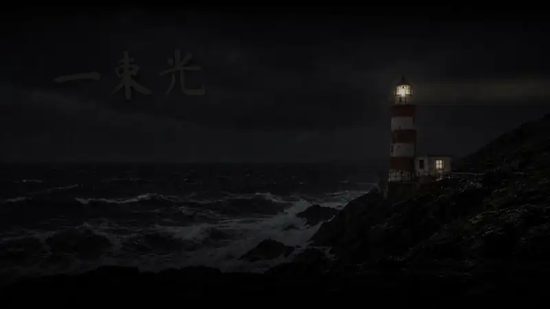

这一页完全由 skill 的流程做出来，源码和底图都在 [`examples/lighthouse/`](examples/lighthouse/)，可以自己重跑：

| 时刻 | 发生什么 | 怎么做的 |
|---|---|---|
| 进页 | 雨夜，灯塔的光束一圈圈扫过海面，扫过天上的"一束光"时字被照亮 | 一张同机位的夜景 + Python 逐帧算光束、雨、灯笼眩光和字的亮度，烧成无缝循环 GIF |
| 点 1 | 镜头缓缓推向灯笼，关键词换掉 | PowerPoint 原生缩放 + 同步位移（焦点不动） |
| 点 2 | 雾从左漫过，天亮了；一条金色航线从渔船画到灯塔脚下，一个光点沿航线走 | 雾 PNG 走原生路径，清晨 GIF 淡入，航线用擦除"画"出来，光点沿折线路径走 |

三张底图是一次生图任务里出的"阴天底片 → 同机位雨夜 → 同机位清晨"，所以逐像素对得上。字幕条里的字都是原生文本框。

### 一份完整的课堂 PPT：《戴珍珠耳环的少女》

<table>
<tr>
<td width="50%"><br><b>展厅开场</b>：黑场 → 画框的灯亮起 → 标题和展签依次浮现</td>
<td width="50%">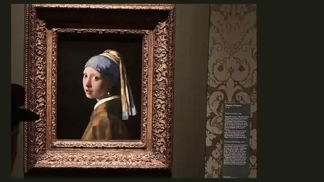<br><b>推进画里</b>：平滑切换，展厅里的画放大成整页</td>
</tr>
<tr>
<td><br><b>光从左边来</b>：软边暗层从左往右退开，再推近到脸</td>
<td>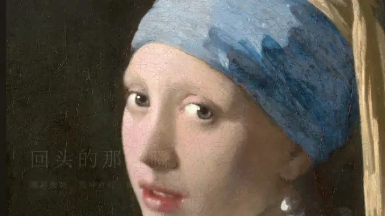<br><b>比黄金还贵的蓝</b>：推近头巾，叠化成青金石和颜料粉</td>
</tr>
<tr>
<td>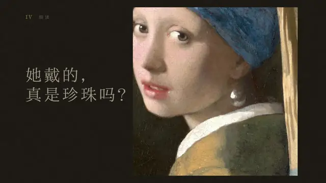<br><b>一颗珍珠，两笔颜料</b>：极近特写 + 引线标注</td>
<td>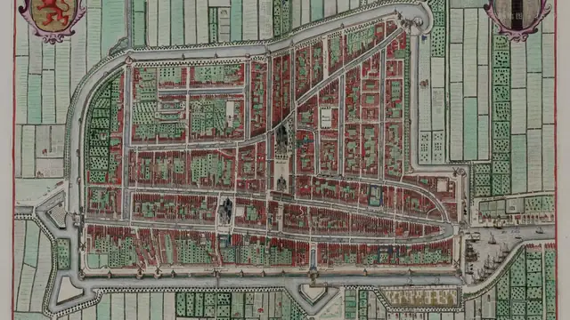<br><b>代尔夫特</b>：老地图缓推，叠化成《代尔夫特一景》</td>
</tr>
<tr>
<td>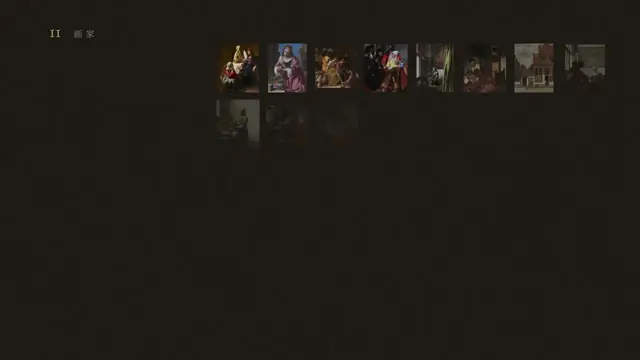<br><b>三十几幅</b>：作品错落铺满，再只留下光从左边来的那几幅</td>
<td><br><b>结尾</b>：画慢慢暗下去，只剩珍珠那一点光</td>
</tr>
</table>

每一页的画面都是从"这一页要讲的那句话"里找出来的，找法写在 [`references/ideation.md`](references/ideation.md)。

### 一份红色题材的课堂 PPT：《江山如此多娇》


<sub>↑ 美术鉴赏课的 8 分钟双人讲解，16 页，全部是 PowerPoint 放映时的真实画面（导出视频截取，已去掉讲解人信息）</sub>

要求是"元素要多，别几页靠动画撑一个东西""宏大、能让老师震撼"。所以每页换一种素材、一种动作：一半是真实材料（原画扫描、毛泽东手迹、建设大会堂的老照片、《千里江山图》真迹长卷、NASA 卫星图），一半是同构图的生成实景。字体单独过了一轮：第一版样张的画面都过了，字却被说"很像 AI 做的 PPT"，换成书法大字、竖排诗句加乌丝栏、仿宋小字和印章以后才定下来，做法写在 [`references/typography.md`](references/typography.md)。

<table>
<tr>
<td width="50%"><br><b>一点朱砂长成太阳</b>：光从画自己的太阳铺开，竖排标题一笔笔写下</td>
<td width="50%">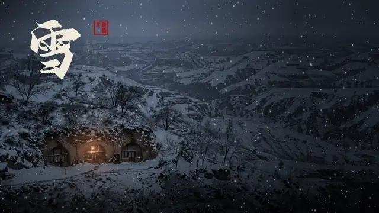<br><b>1936 年的一场雪</b>：窑洞油灯下，《沁园春·雪》手迹一列列写在夜空里</td>
</tr>
<tr>
<td>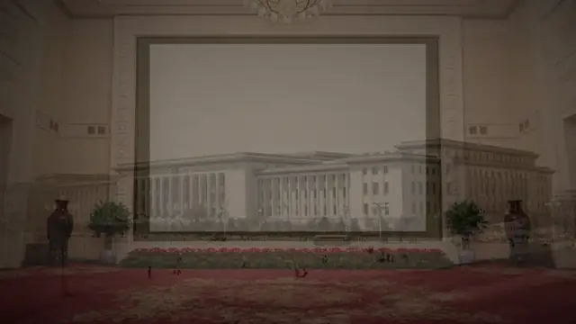<br><b>一面空墙</b>：大会堂迎宾厅的画框被照亮，命题一列列写在墙上</td>
<td>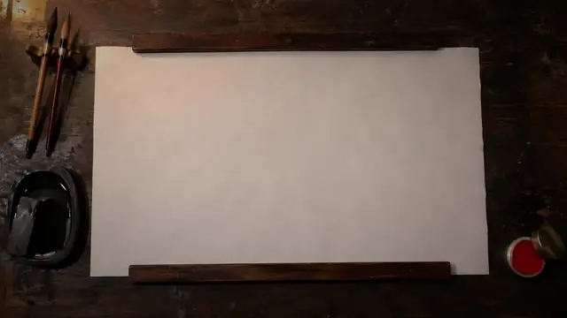<br><b>题字</b>：书桌上逐字写出，再拉远，正好落在画上的题字位置</td>
</tr>
<tr>
<td><br><b>须晴日</b>：画沉在冷夜里，只有太阳是红的；一道光扫过，回到暖色</td>
<td>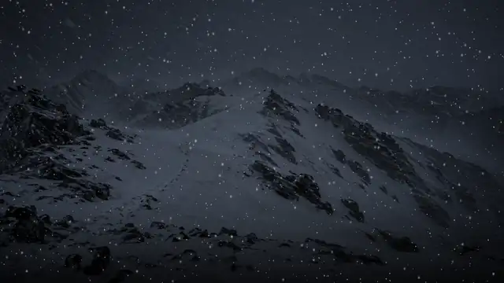<br><b>风雪到晴日</b>：同机位四档天色，每点一下天亮一点，老照片落到时间轴上</td>
</tr>
<tr>
<td>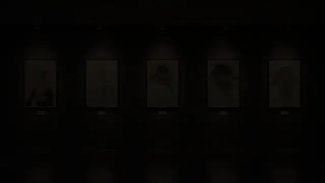<br><b>俱往矣</b>：射灯一盏盏照亮秦皇汉武唐宗宋祖，再一盏盏熄灭</td>
<td>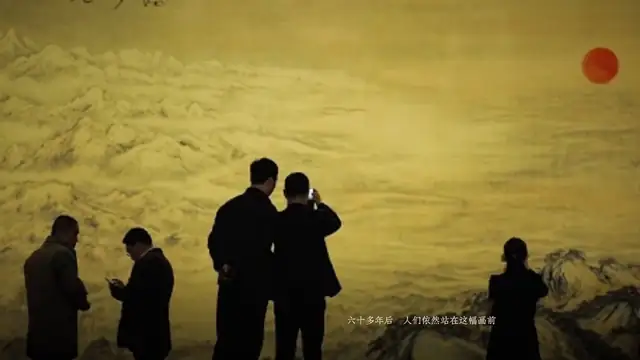<br><b>今朝</b>：画里的山河像墨晕一样一块块变成今天的实景，太阳还在原处</td>
</tr>
</table>

每页的画面怎么从"这一页要讲的那句话"里找出来，写在 [`references/ideation.md`](references/ideation.md) 的第二个例子；全部手法在 [`style-library.md`](references/style-library.md) 第 9 节。

## 它和"让 AI 加个动画"有什么不同

| 常见做法 | 这个 skill |
|---|---|
| 飞入、弹跳、旋转这类预设动画 | 实拍质感的场景 + 有来源的光 + 原生运镜，参考具体的电影镜头 |
| 生成图一眼"AI 感"：青橙调色、光晕、体积光 | 提示词写成"通讯社记者随手拍的新闻照片"，把电影调色点名排除；夜景分两步出 |
| 每张图单独生成，前后对不上 | 一次任务出整套同构图（底片 → 编辑变体 → 分割蒙版），逐像素对齐，可以叠化、做局部动作 |
| 嵌一段视频，改字要回去重渲 | 循环 GIF + PowerPoint 原生动画，文字全是可编辑的文本框 |
| 写完脚本就交付 | 导出放映视频、抽帧拼联系表、逐幕核对顺序、遮挡和字 |
| 一种手法用到底 | 手法库里记着"被否掉的做法和原因"，同一份稿不重复同一种画面 |
| 默认的暗底金线宽字距宋体 | 字体从题材里来：去下载书法、仿宋、篆书字体，拼字样表比，竖排、乌丝栏、印章 |

## 快速开始

**环境**：Windows + 微软 PowerPoint（流程靠 COM 组装）、Python 3.10+、ffmpeg。生图环节需要一个能"以图改图"的生图工具（作者用 Codex CLI 的内置生图），没有的话也可以用自己的照片或素材。

```bash
# 1. 装进 Claude Code 的 skills 目录
git clone https://github.com/Cennyk-learner/ppt-cinematic-animation ~/.claude/skills/ppt-cinematic-animation

# 2. Python 依赖
pip install numpy opencv-python-headless python-pptx pillow
pip install pywin32 fonttools playwright   # 整份稿组装、查缺字、找图时用
```

字体：`ppt_tools.ps1` 默认用开源字体 [Ma Shan Zheng](https://fonts.google.com/specimen/Ma+Shan+Zheng)（书法）、[思源宋体](https://github.com/adobe-fonts/source-han-serif)、[思源黑体](https://github.com/adobe-fonts/source-han-sans)，在开头可以换；`pptkit.py` 默认用《江山如此多娇》那套（演示镇魂行楷、[寒蝉春秋体](https://github.com/Warren2060/ChillCalligraphy)、[朱雀仿宋](https://github.com/TrionesType/zhuque)）。去哪找字、怎么比、怎么装，见 [`references/typography.md`](references/typography.md)。

**先跑一遍自带的例子**，确认环境没问题（不需要生图工具）：

```powershell
cd ~/.claude/skills/ppt-cinematic-animation
python scripts/demo_assets.py D:\work\demo
pwsh -NoProfile -File scripts/build_page_example.ps1 -Work D:\work\demo     # 出 demo.pptx 和预览视频

python examples/lighthouse/render.py D:\work\lighthouse
pwsh -NoProfile -File examples/lighthouse/build.ps1 -Work D:\work\lighthouse  # 出上面那页灯塔
```

**然后直接跟 AI 说**：

> 这是我答辩 PPT 的第 8 页，三栏讲三个原因，太平淡了。帮我发散几个电影感的方向。

> 把这页做成动画：点一下进入一栏，演完自动回到总览。

> 这张底图 AI 感太强了，换成写实的，动画都保留。

skill 会先问清需求、提三四个类型不同的方向、把每一拍讲清楚，确认后再出样张、制作、导出核对。

## 里面有什么

```
SKILL.md                       入口：什么时候用、审美底线、协作顺序、硬约束、流程
references/
  taste.md                     审美与协作原则（每条都对应过一次整体返工）
  ideation.md                  怎么从内容里找画面、怎么写提案，附两个完整例子（单页、整份课堂稿）
  typography.md                字体与版式：什么样子像 AI 模板，中文题材怎么找字、比字、竖排、刻章
  style-library.md             50+ 种做过的手法：开场转场 / 用光讲事 / 用时间讲事 / 对照 /
                               屏幕文件房间 / 平滑切换推近 / 图表文字 / 收尾 /
                               讲一幅画、一段历史 / 被否的做法
  pipeline.md                  生图 → 合成 → 把真实网页界面放进实景屏幕 → 组装 → 核对 → 多版本 →
                               整份稿（选题、找素材、史实、配乐、讲稿）→ 用 Python 组装整份稿
  pitfalls.md                  PowerPoint、COM、平滑切换、生图、合成、字体、素材与配乐、动图体积里踩过的坑
prompts/                       写实底图的提示词模板和例子
scripts/
  render_tools.py              循环动图、透明图层、画线、光束与光照揭示、被照亮的字、屏幕合成、联系表
  ppt_tools.ps1                COM 动画工具：一次点击一幕、路径、推近、拉远、雾转场、字幕条、导出视频
  pptkit.py                    同一套写法的 Python 版，组装整份稿：中文竖排、盖章、匹配剪辑式拉远、配乐、讲稿备注
  scene_tools.py               讲画讲历史：无缝的雪、光从一点铺开、灰到彩色晕开、墨晕式转场、放大镜、老照片、局部上色、去水印
  typo.py                      画在图里的字：手迹转图层、按列切、刻章（朱文/白文）、乌丝栏、查缺字
  fetch_images.py              找真实素材：图片搜索批量下载 + 联系表、Wikimedia Commons 原图
  specimen.py                  字样表：一堆候选字体排在一张图上比，缺字标红
  export_slides.py             整份稿导出核对、逐页导出（可先删掉姓名学号）、剪展示用的动图 WebP
  capture_page.py              把单文件 HTML 界面无头跑起来、按步骤点击、逐帧截图
  cap_show.py                  真实放映时后台截屏
  demo_assets.py / build_page_example.ps1   不靠生图工具的最小例子
examples/lighthouse/           从生图提示词到成品的完整例子
```

## 几条最值钱的经验

摘自 [`pitfalls.md`](references/pitfalls.md) 和 [`taste.md`](references/taste.md)：

- **PPT 里的 GIF 从进入这一页就开始走，不等点击，也不等它出现。** 所以点击之后才发生的叙事过程不能做成一整条 GIF，要拆成逐状态的透明图层，用原生动画按顺序切。
- **"电影感"写进提示词，得到的是 AI 感。** 要真，就写成新闻照片，并点名排除调色、光晕、体积光。
- **震动、闪白、冲击模糊显得廉价。** 有分量的冲击来自运镜和光。
- **平滑切换的 COM 编号是 3954**，3953 是"折纸"。配对靠形状名（`!!` 开头），其余形状名必须全稿唯一，否则同名的字会在切换时乱飞。
- **导出视频会自动往下点**，每一幕只停到最后一个效果。所以加了 `Hold`，让预览视频里每一幕留够时间。
- **一幕只有一张图加一个循环动作，会显得空。** 每一幕至少要有两种不同的动作。
- **字体也会暴露"AI 感"。** 暗底金线、宽字距宋体、细体数字年份那一套，画面再好也会被说像 AI 做的。中文题材去下载书法、仿宋、篆书字体，先拼字样表比。
- **中文竖排文本框要用方向 4**，方向 5 的列是从左往右排的；横排关掉自动换行，居中会失效。

## 常见问题

**Mac 能用吗？** 组装和导出依赖 PowerPoint 的 COM 接口，只能在 Windows 上跑。手法库、审美原则和合成脚本在哪里都能看、能用。

**一定要用 Claude Code 吗？** 不一定。`SKILL.md` 和 `references/` 是普通的 Markdown，任何能读文件、跑命令的 agent 都能照着做。

**没有生图工具怎么办？** 用自己的照片、图库素材也行。合成和组装都不依赖生图；生图只是让"同一机位的几种状态"更容易对齐。

**能做整套 PPT 吗？** 能做整份讲解稿：《江山如此多娇》就是 16 页一起做的，流程见 `pipeline.md` 第 8、9 节。但它不负责通用的排版模板；只要"排得整齐"的稿子，用别的工具更快。

## 致谢与素材说明

- 《戴珍珠耳环的少女》《代尔夫特一景》等维米尔作品和代尔夫特老地图为公有领域，图像来自 Wikimedia Commons；展厅、颜料静物等其余画面为 AI 生成或作者自行拍摄。
- 灯塔例子的底图由 AI 生成，可随本仓库自由使用。
- 《江山如此多娇》（傅抱石、关山月，1959）的图像、毛泽东手迹和建设人民大会堂的历史照片来自公开报道和资料，仅用于课堂讲解与展示，版权归原作者及权利人；《千里江山图》、历代帝王像为公有领域，来自 Wikimedia Commons；卫星影像来自 NASA Blue Marble。陕北雪原、迎宾厅空墙、展厅、雪中长城、雪山天色、展柜、"今天的中国"等画面为 AI 生成。课堂放映用的配乐没有随仓库分发。
- `ppt_tools.ps1` 的默认字体为 SIL Open Font License；其余中文字体的授权见各自项目。

## License

[MIT](LICENSE)
