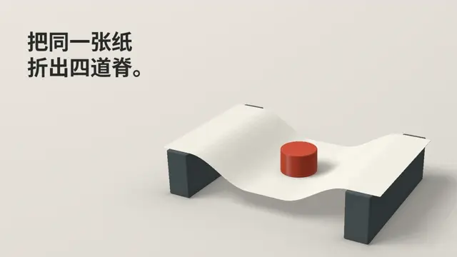

# 一张纸，能撑住它吗？

[下载可编辑 PPTX](paper-bridge.pptx?raw=1) · [观看 20 秒预览](preview.mp4) · [查看关键帧](review.jpg)



五页中文动画样片。第 2、5 页从同一机位加载同一枚砝码，直接比较平纸和折纸的变形。第 3 页的镜头沿折叠过程转向纸的端部，第 4 页接上可编辑的截面图。所有标题、角度和尺寸均可在 PowerPoint 内编辑，讲解词在各页备注里。

从封面翻页四次即可走完整份样片。MP4 按同一组三维图像帧、原生图解的位置和分镜节奏合成。

折面的横截线长 20 mm，与水平夹角为 60°，峰谷高度等于 20 × sin(60°)，约 17.3 mm。受力变形是定性示意。实验背景见[曼彻斯特大学的纸桥课堂活动](https://www.mub.eps.manchester.ac.uk/wp-content/uploads/sites/86/2021/10/Different-cross-sections-of-a-paper-bridge.pdf)。

## 重新生成

安装 Python 3、NumPy、Pillow 和 python-pptx。MP4 预览另需 FFmpeg、ffprobe 和中文字体。Linux 默认读取 Noto Sans CJK；可用 `PAPER_FONT_REGULAR` 与 `PAPER_FONT_BOLD` 指定字体文件。通过 `PAPER_TYPEFACE` 选择 PPT 的中文字体。

在仓库根目录运行：

```sh
BRIDGE_OUT=examples/paper-bridge/frames python examples/paper-bridge/render_scene.py all
python examples/paper-bridge/build_demo.py
python examples/paper-bridge/verify.py
```

`output/` 包含可编辑的 PPTX 和 20 秒的 MP4，`assembled/review.jpg` 是预览关键帧。重复运行会重建样片。
